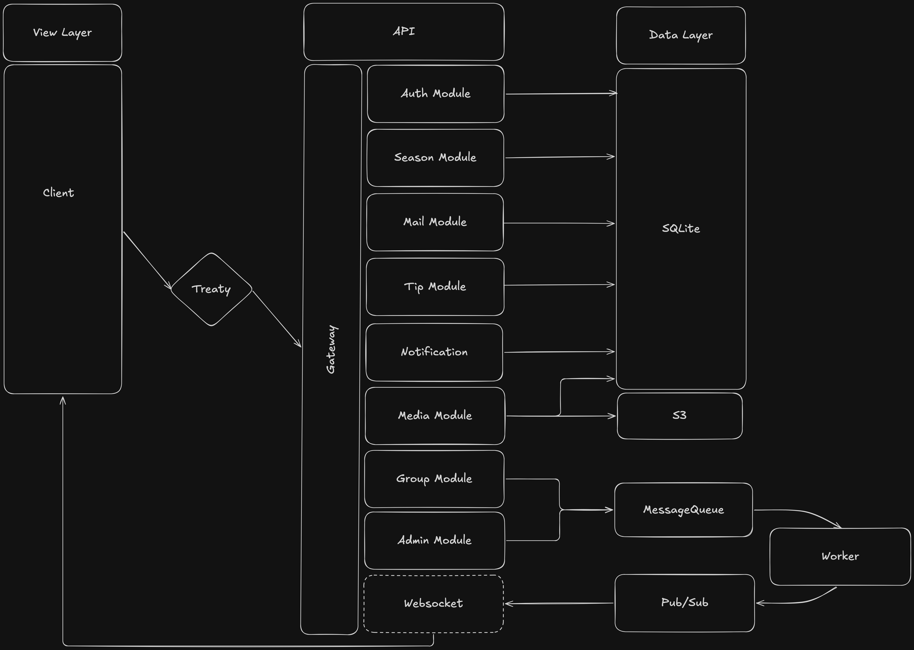

# HSCBet

Tippspiel-Plattform für den HSC 2000 Coburg. Das Projekt ist ein [Turborepo](https://turborepo.dev/)-Monorepo und nutzt [Bun](https://bun.sh/) als Paketmanager und Runtime.

## Welche Anleitung?

|                      | [Development](#development-lokal)                | [Production](#production-server)                                 |
| -------------------- | ------------------------------------------------ | ---------------------------------------------------------------- |
| **Wofür**            | Am Code arbeiten, lokal ausprobieren             | Die Anwendung auf einem Server für echte Nutzer betreiben        |
| **Wo läuft was**     | API und Web lokal mit Hot-Reload, Rest in Docker | Alles in Docker                                                  |
| **Compose-Datei**    | `docker-compose-dev.yml`                         | `docker-compose-prod.yml`                                        |
| **Benötigt**         | Bun, Docker Desktop                              | Docker, eigene Domain, Reverse Proxy (z. B. Caddy), Resend-Konto |
| **Erreichbar unter** | http://localhost:3000                            | `https://<deine-domain>`                                         |

## Aufbau

| Pfad                | Inhalt                                                     |
| ------------------- | ---------------------------------------------------------- |
| `apps/web`          | Frontend (Next.js)                                         |
| `apps/api`          | Backend (Elysia auf Bun)                                   |
| `packages/database` | Prisma-Schema, Migrationen und Client (SQLite über libSQL) |
| `packages/auth`     | Authentifizierung (Better Auth)                            |
| `packages/bucket`   | Dateispeicher (MinIO / S3)                                 |
| `packages/queue`    | Job-Queue (Redis)                                          |
| `packages/worker`   | Worker für Hintergrund-Jobs (läuft in Docker)              |
| `packages/pub-sub`  | Pub/Sub über Redis                                         |
| `packages/treaty`   | Typisierter API-Client für das Frontend                    |
| `packages/logger`   | Gemeinsamer Logger                                         |
| `scripts`           | Seed- und Admin-Scripts für die Datenbank                  |
| `docs/architecture` | Systemdiagramm                                             |

## Architektur



Das Frontend spricht die API über den typisierten Treaty-Client an. Die API-Module speichern in SQLite, Dateien landen in S3 (MinIO). Gruppen- und Admin-Aktionen legen Jobs in die Message Queue (Redis), die der Worker abarbeitet. Ergebnisse gehen über Pub/Sub zurück an die API und von dort per WebSocket an den Client.

---

## Development (lokal)

### Voraussetzungen

- [Bun](https://bun.sh/) in der Version aus `package.json` (`packageManager`, aktuell `1.4.2`)
- [Docker Desktop](https://www.docker.com/) inklusive Docker Compose. Docker muss laufen, bevor `bun docker:dev` ausgeführt wird.

### Einrichtung

Alle Befehle werden im Projekt-Root ausgeführt.

#### 1. Abhängigkeiten installieren

```sh
bun install
```

#### 2. `.env`-Dateien anlegen

Im Projekt-Root, in `apps/api`, `apps/web` und in jedem Package unter `packages/` liegt eine `.env.example` mit allen Variablen. Daraus muss jeweils eine `.env` erstellt werden, weil Bun, Next.js und die Prisma CLI die `.env` im eigenen Arbeitsverzeichnis laden. Alle `.env`-Dateien haben denselben Inhalt.

Zuerst die `.env` im Root anlegen:

```sh
cp .env.example .env
```

Dann in der `.env` die `YOUR_...`-Platzhalter ersetzen. Für die lokale Entwicklung funktionieren diese Werte:

```env
# Database configuration
DATABASE_URL="file:./data/hscbet.db"

# Server configuration
API_SERVER_PORT=3001
WEB_SERVER_PORT=3000
API_SERVER_URL=http://localhost:3001
WEB_SERVER_URL=http://localhost:3000
NEXT_PUBLIC_API_SERVER_URL=http://localhost:3001
NEXT_PUBLIC_WS_URL=ws://localhost:3001/api/socket

# BetterAuth configuration
BETTER_AUTH_SECRET=<zufälliger Wert, siehe unten>
BETTER_AUTH_URL=http://localhost:3001
NEXT_PUBLIC_AUTH_BASE_URL=http://localhost:3001

# Minio configuration
MINIO_CONTAINER_NAME=hscbet-minio
MINIO_ROOT_USER=<frei wählbar, z. B. minio>
MINIO_ROOT_PASSWORD=<frei wählbar, mindestens 8 Zeichen>
MINIO_PORT=9000
MINIO_CONSOLE_PORT=9001
MINIO_ENDPOINT=http://localhost:9000
MINIO_PUBLIC_ENDPOINT=http://localhost:9000
MINIO_REGION=eu-central-1
MINIO_BUCKET_NAME=hscbet-bucket
MINIO_S3_PRESIGNED_URL_EXPIRATION_TIME=3600

# Redis configuration
REDIS_CONTAINER_NAME=hscbet-redis
REDIS_PORT=6379
REDIS_HOST=localhost

# Admin configuration
ADMIN_API_KEY=<zufälliger Wert, siehe unten>
SIGNUP_REVIEW_MAIL_ADDRESS=<E-Mail-Adresse, die neue Registrierungen freigibt>

# Mail configuration (Resend)
RESEND_API_KEY=
RESEND_MAIL_ADDRESS=
```

- `BETTER_AUTH_SECRET` und `ADMIN_API_KEY` sind beliebige, lange Zufallswerte, z. B. aus `openssl rand -base64 32`.
- `DATABASE_URL` bleibt so. Relative Pfade werden immer relativ zu `packages/database` aufgelöst, alle Apps nutzen also dieselbe Datei.
- `RESEND_API_KEY` und `RESEND_MAIL_ADDRESS` können lokal leer bleiben. Was dann nicht funktioniert, steht unter [Ohne Resend](#ohne-resend).

Danach die fertige `.env` in alle anderen Ordner kopieren:

```sh
for d in apps/api apps/web packages/*; do cp .env "$d/.env"; done
```

> [!IMPORTANT]
> Wird später eine Variable geändert, muss die Root-`.env` erneut in alle Ordner kopiert werden (gleicher Befehl). Sonst arbeiten API, Web und Prisma mit unterschiedlichen Werten.

#### 3. Infrastruktur starten (Docker)

```sh
bun docker:dev
```

Startet in Docker:

- **MinIO** (Dateispeicher) auf Port 9000, Web-Konsole unter http://localhost:9001 (Login mit `MINIO_ROOT_USER` / `MINIO_ROOT_PASSWORD`)
- **minio-init**, legt einmalig den Bucket `MINIO_BUCKET_NAME` an und beendet sich danach
- **Redis** auf Port 6379
- den **Worker** für Hintergrund-Jobs. Er bindet `packages/database/data` als Volume ein und nutzt so dieselbe SQLite-Datei wie API und Scripts.

> [!NOTE]
> `docker-compose-dev.yml` startet nur die Infrastruktur-Services und den Worker. Backend (API) und Frontend (Web) laufen **nicht** in einem Container, sondern lokal mit Hot-Reload (Schritt 6). Soll alles in Containern laufen, siehe [Production](#production-server).

#### 4. Datenbank migrieren

```sh
bun db:migrate:dev
```

Legt die SQLite-Datei `packages/database/data/hscbet.db` an und spielt alle Migrationen ein.

#### 5. Prisma Client generieren

```sh
bun db:generate
```

Erzeugt den Prisma Client nach `packages/database/generated/`. Ohne diesen Schritt starten API und Web nicht.

#### 6. Entwicklungsserver starten

```sh
bun dev
```

Startet API und Web parallel über Turborepo:

- Web: http://localhost:3000
- API: http://localhost:3001

#### 7. Nutzer anlegen und Admin-Rechte vergeben

Unter http://localhost:3000/signup einen Account registrieren. Neue Accounts müssen freigegeben werden, bevor man sich anmelden kann. Ohne Resend-Konfiguration geht das über Prisma Studio, siehe [Ohne Resend](#ohne-resend).

Danach den Account zum Admin machen:

```sh
bun db:admin du@example.com
```

Mit `--revoke` wird die Rolle wieder entzogen. Mehrere E-Mail-Adressen sind möglich.

### Kurzfassung Development

```sh
bun install
cp .env.example .env
# .env ausfüllen (siehe Schritt 2), dann:
for d in apps/api apps/web packages/*; do cp .env "$d/.env"; done
bun docker:dev
bun db:migrate:dev
bun db:generate
bun dev
# im Browser registrieren und freischalten (siehe Schritt 7), dann:
bun db:admin du@example.com
```

### Testdaten (optional)

Für eine schnell befüllte Oberfläche zum Entwickeln und Ausprobieren gibt es ein Seed-Script. Es ist für das Setup nicht nötig:

```sh
bun db:seed
```

Legt Saisons, Spiele, Tipps, Gruppen und bereits freigegebene Demo-Nutzer an. Alle Demo-Nutzer haben das Passwort `Test123!`, zum Beispiel:

| E-Mail                     | Passwort   |
| -------------------------- | ---------- |
| `test@example.com`         | `Test123!` |
| `anna.fischer@example.com` | `Test123!` |
| `max.weber@example.com`    | `Test123!` |

Mit diesen Nutzern kann man sich direkt anmelden, Registrierung und Freigabe entfallen. Admin-Rechte vergibt man wie oben, z. B. `bun db:admin test@example.com`.

Das Script löscht vorher seine eigenen alten Seed-Daten und kann beliebig oft ausgeführt werden.

> [!WARNING]
> Nur lokal verwenden, nie auf einem Server. Die Demo-Nutzer haben ein öffentlich bekanntes Passwort.

`bun db:seed` schreibt in die lokale Datei `packages/database/data/hscbet.db`. Wer lokal den Production-Stack (`docker-compose-prod.yml`) ausprobiert, muss das Script im Container ausführen, weil dieser eine eigene Datenbank im Docker-Volume nutzt:

```sh
docker compose -f docker-compose-prod.yml exec api bun /app/scripts/seed.ts
```

### Ohne Resend

Solange `RESEND_API_KEY` und `RESEND_MAIL_ADDRESS` leer sind, werden keine E-Mails verschickt. Das betrifft:

- **Registrierung:** Neue Accounts sind zunächst nicht freigegeben und brauchen die Review-Mail an `SIGNUP_REVIEW_MAIL_ADDRESS`. Ohne Mail kann man sich mit einem neu registrierten Account nicht anmelden.
- Passwort vergessen, E-Mail-Bestätigung und E-Mail-Änderung

Einen neu registrierten Account schaltet man frei, indem man `bun db:studio` ausführt und in Prisma Studio beim Nutzer in der Tabelle `User` das Feld `approved` auf `true` setzt. Alternativ die bereits freigegebenen Nutzer aus den [Testdaten](#testdaten-optional) verwenden.

### Alltag

Nach dem ersten Setup reicht in der Regel:

```sh
bun docker:dev   # falls die Container nicht mehr laufen
bun dev
```

Nach einem `git pull` mit neuen Migrationen oder Abhängigkeiten:

```sh
bun install
bun db:migrate:dev
bun db:generate
```

Container stoppen:

```sh
docker compose -f docker-compose-dev.yml down
```

### Schema ändern

1. `packages/database/prisma/schema.prisma` anpassen
2. `bun db:migrate:dev` ausführen und einen Namen für die Migration vergeben
3. `bun db:generate` ausführen
4. Die neue Migration unter `packages/database/prisma/migrations/` mit committen

### Vor einem Pull Request

Die CI prüft Linting und Formatierung. Lokal vorab:

```sh
bun lint
bun run oxfmt --check apps packages
```

Bei Formatierungsfehlern hilft `bun format`.

---

## Production (Server)

`docker-compose-prod.yml` startet die komplette Anwendung in Containern: Web, API, Worker, MinIO, Redis und einen Migrations-Service, der bei jedem Start die Datenbank aktualisiert. Abhängigkeiten, Prisma Client und der Frontend-Build entstehen beim Bauen der Images. Auf dem Server sind deshalb **kein Bun, kein `bun install` und keine manuellen Migrationen** nötig.

### Voraussetzungen

- Ein Linux-Server mit [Docker Engine und Docker Compose](https://docs.docker.com/engine/install/) sowie `git`
- Eine Domain mit drei (Sub-)Domains, deren DNS-Einträge (A/AAAA) auf die IP des Servers zeigen. In den Beispielen:

  | Domain               | Dienst                         | Interner Port |
  | -------------------- | ------------------------------ | ------------- |
  | `hscbet.example`     | Web                            | `3000`        |
  | `api.hscbet.example` | API (inkl. WebSocket)          | `3001`        |
  | `s3.hscbet.example`  | MinIO (Bild-Upload und -Abruf) | `9000`        |

- Die Ports **80 und 443** sind in der Firewall des Servers offen
- Ein Reverse Proxy für HTTPS, z. B. [Caddy](https://caddyserver.com/docs/install)
- Ein Konto bei [Resend](https://resend.com/) mit verifizierter Absender-Domain. Ohne Mail-Versand kann sich niemand registrieren.

### 1. Repo klonen

```sh
git clone <repo-url> hscbet
cd hscbet
```

### 2. `.env` anlegen

Auf dem Server wird **nur die `.env` im Projekt-Root** gebraucht. Die Dateien in den Unterordnern sind nur für die lokale Entwicklung.

```sh
cp .env.example .env
```

Dann den Inhalt der `.env` durch diese Vorlage ersetzen und die Domains und `<...>`-Werte anpassen:

```env
# Database configuration (wird von docker-compose-prod.yml vorgegeben)
DATABASE_URL="file:./data/hscbet.db"

# Server configuration
API_SERVER_PORT=3001
WEB_SERVER_PORT=3000
API_SERVER_URL=https://api.hscbet.example
WEB_SERVER_URL=https://hscbet.example
NEXT_PUBLIC_API_SERVER_URL=https://api.hscbet.example
NEXT_PUBLIC_WS_URL=wss://api.hscbet.example/api/socket

# BetterAuth configuration
BETTER_AUTH_SECRET=<zufälliger Wert>
BETTER_AUTH_URL=https://api.hscbet.example
NEXT_PUBLIC_AUTH_BASE_URL=https://api.hscbet.example

# Minio configuration
MINIO_CONTAINER_NAME=hscbet-minio
MINIO_ROOT_USER=<frei wählbar, z. B. hscbet>
MINIO_ROOT_PASSWORD=<zufälliger Wert>
MINIO_PORT=9000
MINIO_CONSOLE_PORT=9001
MINIO_ENDPOINT=http://minio:9000
MINIO_PUBLIC_ENDPOINT=https://s3.hscbet.example
MINIO_REGION=eu-central-1
MINIO_BUCKET_NAME=hscbet-bucket
MINIO_S3_PRESIGNED_URL_EXPIRATION_TIME=3600

# Redis configuration (wird von docker-compose-prod.yml vorgegeben)
REDIS_CONTAINER_NAME=hscbet-redis
REDIS_PORT=6379
REDIS_HOST=redis

# Admin configuration
ADMIN_API_KEY=<zufälliger Wert>
SIGNUP_REVIEW_MAIL_ADDRESS=<E-Mail-Adresse, die neue Registrierungen freigibt>

# Mail configuration (Resend)
RESEND_API_KEY=<API-Key von resend.com>
RESEND_MAIL_ADDRESS=<Absender, z. B. noreply@hscbet.example>
```

- **Zufallswerte** für `BETTER_AUTH_SECRET`, `MINIO_ROOT_PASSWORD` und `ADMIN_API_KEY` jeweils neu erzeugen, z. B. mit `openssl rand -base64 32`. Niemals die Werte aus der lokalen Entwicklung übernehmen.
- **`https://` und `wss://`**: Alle öffentlichen Adressen laufen über HTTPS.
- **Frontend und API unter derselben Domain** betreiben (z. B. `hscbet.example` und `api.hscbet.example`). Sonst schickt der Browser die Session-Cookies nicht mit und der Login funktioniert nicht.
- `DATABASE_URL`, `MINIO_ENDPOINT`, `REDIS_HOST` und `REDIS_PORT` setzt `docker-compose-prod.yml` selbst auf die internen Container-Adressen.
- Fehlen Pflichtwerte wie `NEXT_PUBLIC_API_SERVER_URL` oder die MinIO-Zugangsdaten, bricht der Start mit einer Meldung wie `... fehlt in .env` ab.

### 3. Starten

```sh
docker compose -f docker-compose-prod.yml up -d --build
```

Der erste Build dauert einige Minuten. Danach prüfen, ob alles läuft:

```sh
docker compose -f docker-compose-prod.yml ps -a
```

`api`, `web`, `worker`, `minio` und `redis` sollten `running` sein, `migrate` und `minio-init` `exited (0)`. Sie laufen nur einmal beim Start und beenden sich dann.

> [!IMPORTANT]
> `NEXT_PUBLIC_*` werden beim Build fest in das Frontend eingebaut. Nach einer Änderung dieser Werte muss mit `--build` neu gestartet werden.

### 4. Reverse Proxy mit HTTPS einrichten

Die Container sind nur auf dem Server selbst erreichbar (`127.0.0.1`). Nach außen gehen sie über den Reverse Proxy, der auch HTTPS übernimmt. Mit Caddy reicht diese `Caddyfile` (unter Linux meist `/etc/caddy/Caddyfile`):

```caddyfile
hscbet.example {
	reverse_proxy localhost:3000
}

api.hscbet.example {
	reverse_proxy localhost:3001
}

s3.hscbet.example {
	reverse_proxy localhost:9000
}
```

Danach Caddy neu laden, z. B. mit `sudo systemctl reload caddy`. Caddy holt die HTTPS-Zertifikate automatisch, sobald die DNS-Einträge auf den Server zeigen. WebSockets werden ebenfalls automatisch weitergeleitet.

Jetzt ist die Seite unter `https://hscbet.example` erreichbar.

### 5. Ersten Admin anlegen

1. Auf der Seite unter `/signup` registrieren.
2. Die Registrierung über den Link in der Freigabe-Mail an `SIGNUP_REVIEW_MAIL_ADDRESS` bestätigen.
3. Den Account zum Admin machen:

   ```sh
   docker compose -f docker-compose-prod.yml exec api bun /app/scripts/admin.ts du@example.com
   ```

Als Admin lassen sich danach Saisons und Spiele über die Oberfläche anlegen.

### Kurzfassung Production

```sh
git clone <repo-url> hscbet && cd hscbet
cp .env.example .env
# .env ausfüllen (siehe Schritt 2), dann:
docker compose -f docker-compose-prod.yml up -d --build
# Caddy einrichten (siehe Schritt 4), auf der Seite registrieren und freigeben, dann:
docker compose -f docker-compose-prod.yml exec api bun /app/scripts/admin.ts du@example.com
```

### Betrieb

**Update auf eine neue Version.** Migrationen laufen dabei automatisch, die Daten bleiben erhalten:

```sh
git pull
docker compose -f docker-compose-prod.yml up -d --build
```

**Logs ansehen**, z. B. der API:

```sh
docker compose -f docker-compose-prod.yml logs -f api
```

**Stoppen und wieder starten:**

```sh
docker compose -f docker-compose-prod.yml down
docker compose -f docker-compose-prod.yml up -d
```

> [!CAUTION]
> Niemals `down -v` verwenden. Das `-v` löscht die Volumes und damit **alle Daten** (Datenbank und Bilder).

**Backups.** Die Daten liegen in den Docker-Volumes `hscbet-prod_sqlite_data` (Datenbank) und `hscbet-prod_minio_data` (Bilder). Am sichersten wird bei gestoppten Containern gesichert:

```sh
docker compose -f docker-compose-prod.yml down
docker run --rm -v hscbet-prod_sqlite_data:/data -v "$PWD":/backup alpine tar czf /backup/sqlite-backup.tar.gz -C /data .
docker run --rm -v hscbet-prod_minio_data:/data -v "$PWD":/backup alpine tar czf /backup/minio-backup.tar.gz -C /data .
docker compose -f docker-compose-prod.yml up -d
```

Wiederherstellen (ebenfalls bei gestoppten Containern):

```sh
docker run --rm -v hscbet-prod_sqlite_data:/data -v "$PWD":/backup alpine tar xzf /backup/sqlite-backup.tar.gz -C /data
docker run --rm -v hscbet-prod_minio_data:/data -v "$PWD":/backup alpine tar xzf /backup/minio-backup.tar.gz -C /data
```

### Sicherheit

- **`bun db:seed` nie auf dem Server ausführen.** Die Demo-Nutzer haben das öffentlich bekannte Passwort `Test123!`.
- Redis läuft ohne Passwort und ist nur innerhalb des Docker-Netzwerks erreichbar. Daran nichts ändern.
- Die MinIO-Konsole ist in Production absichtlich nicht erreichbar.
- Die `.env` enthält alle Secrets. Sie wird nicht committet und nicht in die Docker-Images kopiert.

---

## Alle Scripts

| Befehl                 | Beschreibung                                                         |
| ---------------------- | -------------------------------------------------------------------- |
| `bun dev`              | Startet API und Web im Entwicklungsmodus                             |
| `bun run build`        | Baut alle Apps und Packages                                          |
| `bun docker:dev`       | Startet MinIO, Redis und den Worker in Docker (Development)          |
| `bun docker:prod`      | Baut und startet die komplette Anwendung in Docker (Production)      |
| `bun db:migrate:dev`   | Spielt Migrationen ein bzw. erzeugt nach Schema-Änderungen eine neue |
| `bun db:generate`      | Generiert den Prisma Client                                          |
| `bun db:migrate:reset` | Setzt die Datenbank komplett zurück (**alle Daten gehen verloren**)  |
| `bun db:seed`          | Spielt optionale Testdaten ein (nur lokal)                           |
| `bun db:admin <email>` | Vergibt Admin-Rechte (`--revoke` entzieht sie)                       |
| `bun db:studio`        | Öffnet Prisma Studio zum Ansehen und Bearbeiten der Datenbank        |
| `bun lint`             | Lintet den Code mit oxlint                                           |
| `bun format`           | Formatiert den Code mit oxlint und oxfmt                             |
| `bun check-types`      | Prüft die TypeScript-Typen in allen Packages                         |

`bun docker:prod` ist eine Abkürzung für `docker compose -f docker-compose-prod.yml up --build -d`. Auf einem Server ohne Bun den Befehl direkt verwenden.

## Fehlerbehebung

### Development

- **API oder Web starten nicht, Fehler zum Prisma Client:** `bun db:generate` ausführen.
- **`Missing required S3/MinIO environment variables`:** In der `.env` des betroffenen Ordners fehlen MinIO-Werte. Root-`.env` erneut in alle Ordner kopieren.
- **`Missing NEXT_PUBLIC_AUTH_BASE_URL`:** `apps/web/.env` fehlt oder ist unvollständig. Nach dem Anpassen `bun dev` neu starten, da Next.js `NEXT_PUBLIC_*`-Variablen nur beim Start einliest.
- **„Dein Account wurde noch nicht freigegeben":** siehe [Ohne Resend](#ohne-resend).
- **Port belegt:** Prüfen, ob noch eine alte Instanz von `bun dev` oder ein anderer Container auf 3000, 3001, 6379, 9000 oder 9001 läuft.

### Production

Bei Problemen zuerst die Logs ansehen: `docker compose -f docker-compose-prod.yml logs api web`.

- **Start bricht mit `... fehlt in .env` ab:** Der genannte Wert fehlt in der Root-`.env` oder ist leer.
- **Seite von außen nicht erreichbar:** Prüfen, ob die DNS-Einträge auf den Server zeigen (`ping hscbet.example`), die Ports 80 und 443 offen sind und Caddy läuft (`systemctl status caddy`).
- **Seite lädt, aber Login oder Daten funktionieren nicht:** Meist stimmen die URLs nicht. `WEB_SERVER_URL` muss exakt die Adresse sein, unter der die Seite aufgerufen wird, die `NEXT_PUBLIC_*`-Werte die der API. Nach dem Korrigieren mit `--build` neu starten.
- **Bilder laden nicht oder Upload schlägt fehl:** `MINIO_PUBLIC_ENDPOINT` prüfen. Die Adresse muss aus dem Browser erreichbar sein und im Reverse Proxy auf Port 9000 zeigen.
- **Keine Freigabe-Mail nach der Registrierung:** `RESEND_API_KEY`, `RESEND_MAIL_ADDRESS` und `SIGNUP_REVIEW_MAIL_ADDRESS` prüfen. Die Absender-Domain muss bei Resend verifiziert sein. Fehler stehen in `docker compose -f docker-compose-prod.yml logs api`.
- **`migrate` endet nicht mit `exited (0)`:** `docker compose -f docker-compose-prod.yml logs migrate` zeigt den Fehler.

## Lizenz

Veröffentlicht unter der [MIT-Lizenz](LICENSE). Der Code darf frei genutzt, verändert, gehostet und weitergegeben werden, solange der Lizenztext mit dem Copyright-Hinweis erhalten bleibt. Eine Gewährleistung gibt es nicht.
